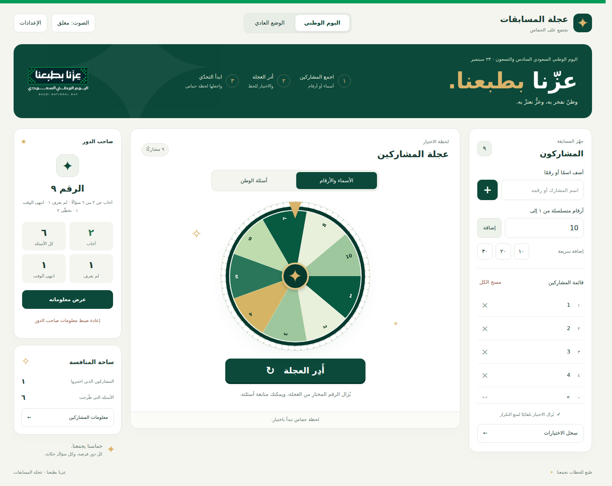
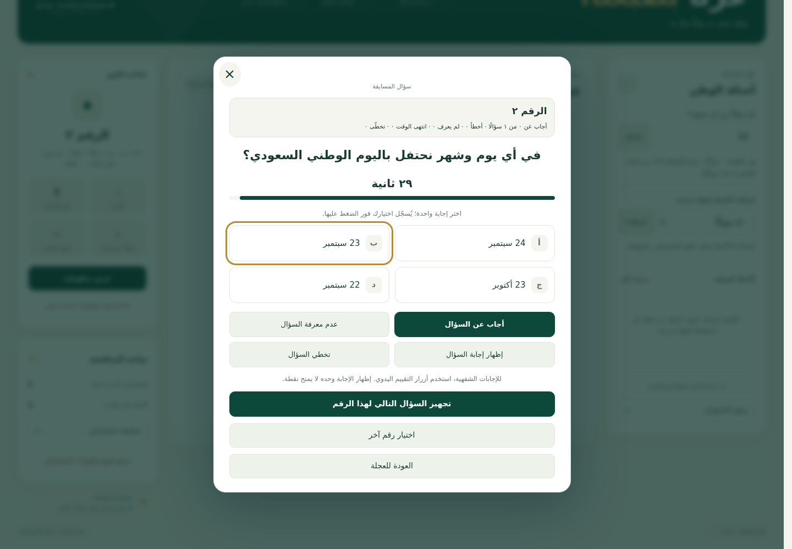

# عزنا بطبعنا — عجلة المسابقات

واجهة عربية تجمع عجلة اختيار المشاركين وأسئلة الوطن، وعرض اليوم الوطني من Canva، ووضع «اختيار الشخصية»، جاهزة للاستضافة على Vercel.



[نتائج التحقق](docs/VALIDATION.md)

## النسخة الحالية

مصدر الموقع الحالي في مجلد `site/`:

- `index.html`: الواجهة والنوافذ.
- `style.css`: التنسيق للشاشات الصغيرة والكبيرة.
- `app.js`: منطق المسابقة والحفظ والتصحيح.
- `questions.js`: بنك الأسئلة واختياراتها.
- `assets/`: الصور والأيقونة المحلية.

ملفات React الموجودة سابقًا في جذر المستودع باقية كمرجع. إعداد `vercel.json` ينشر مجلد `site` مباشرة، دون تثبيت حزم أو تشغيل بناء React.

## المزايا

- وضع اليوم الوطني والوضع العادي.
- وضع «اختيار الشخصية»: ٦٠ عبارة عربية أصلية، ومقياس موافقة من سبع درجات، ونسب خمسة أبعاد، والأنماط الـ١٦ ضمن المحللين والدبلوماسيين والحراس والمستكشفين.
- عرض Canva داخل وضع اليوم الوطني فقط، بنسبة ١٦:٩، مع خيار الإخفاء والإظهار ودعم ملء الشاشة. لا يظهر ولا يُحمّل في الوضع العادي أو اختيار الشخصية.
- مقدمة وخطوات مرتبة من مشاهدة العرض إلى تجهيز المشاركين وبدء التحدي، مع رابط مباشر إلى ساحة المسابقة.
- إضافة الأسماء والأرقام، بما فيها الأرقام العربية، والإضافة السريعة.
- بنك من ١٥٠ سؤالًا؛ لكل سؤال أربع اختيارات متقاربة في موضوعها، مع ترتيب عشوائي محفوظ طوال السؤال.
- التصحيح الفوري عند الضغط على الاختيار، وحفظ اختيار المشارك ونتيجته، مع منع التكرار والإجابة بعد انتهاء الوقت.
- إضافة الأسئلة واستعادتها.
- دوران تلقائي، وإيقاف مبكر للاختيار، وإلغاء الدوران دون استهلاك الاختيار.
- اختيار صاحب الدور أولًا؛ بدء عجلة الأسئلة يتم يدويًا.
- مؤقت للإجابة، وإظهار الإجابة، واحتساب الصحيح وعدم المعرفة والتخطي وانتهاء الوقت.
- معلومات ونتائج كل مشارك، وإعادة ضبط معلومات صاحب الدور الحالي.
- زر «مسح جميع معلومات المشاركين والأرقام» داخل نافذة معلومات صاحب الرقم، وزر مماثل في ساحة المنافسة. بعد التأكيد يحذف جميع الأسماء والأرقام في الوضعين، ومعلومات المشاركين وأسئلتهم ونتائجهم والسجل، ويعيد الأسئلة لجولة جديدة مع الاحتفاظ بإعدادات الصوت والوقت.
- سجل قابل للمسح، وصوت واحتفال وإعدادات محفوظة.
- دعم لوحة المفاتيح وتقليل الحركة، وعرض متجاوب من الجوال إلى الكمبيوتر.



تظل أزرار التقييم اليدوي متاحة للإجابات الشفهية. اختيار إجابة خاطئة يُسجّل نتيجة «إجابة غير صحيحة» مستقلة عن «لم يعرف الإجابة». تبقى النتائج التاريخية محفوظة عند تحديث الموقع، وتضاف الاختيارات إلى أسئلة البنك التي لم تُطرح بعد.

## الاستضافة على Vercel

1. من لوحة Vercel اختر **Add New → Project**.
2. استورد مستودع **maxmanar/maxman.wheel** واختر فرع **main**.
3. اترك **Root Directory** على جذر المستودع، ثم اختر **Deploy**.

يتولى `vercel.json` الإعدادات: **Framework Preset: Other**، ومجلد النشر **site**، دون أوامر تثبيت أو بناء. إذا طُلبت الإعدادات يدويًا، استخدم هذه القيم. لا توجد مفاتيح أو متغيرات بيئة مطلوبة.

مرجع الإعدادات: [وثائق Vercel](https://vercel.com/docs/project-configuration/vercel-json).

## الحفظ

اختبار الشخصية يحفظ الإجابات والتقدم والنتيجة تحت مفتاح مستقل `maxman-personality-v1`. إعادة الاختبار لا تمسح بيانات المسابقة، ومسح بيانات المشاركين لا يمسح إجابات اختبار الشخصية. يمكن مغادرة الوضع والعودة أو تحديث الصفحة لاستكمال الإجابات.

تُحفظ بيانات المسابقة في متصفح المستخدم على عنوان الموقع نفسه. لا تُرفع أسماء المشاركين أو نتائجهم إلى GitHub أو إلى قاعدة بيانات، ولا تتزامن بين الأجهزة. فتح عنوان جديد أو الانتقال من ملف محلي إلى الموقع المستضاف يستخدم مساحة حفظ مختلفة.

تقرأ النسخة الجديدة بيانات `izzna-wheel-v1`، وتستورد بيانات النسخة الأصلية عند وجودها على العنوان نفسه. إذا منع المتصفح الحفظ، تظهر رسالة واضحة ويمكن متابعة اللعب للجلسة الحالية.

## اختبار اختيار الشخصية

الملفات `site/personality-data.js` و`site/personality.js` و`site/personality.css` تضم الأسئلة والحساب والواجهة. توجد عشر صفحات، في كل منها ست عبارات، ولا تظهر النتيجة إلا بعد الإجابة عن جميع العبارات. يتوفر دليل لجميع الأنماط الـ١٦ مع أوصاف عربية أصلية ورموز SVG أصلية.

الأبعاد: الطاقة (E/I)، والعقل (N/S)، والطبيعة (T/F)، والأسلوب (J/P)، والهوية (A/T). لكل بُعد ١٢ عبارة متساوية الوزن: ست في الاتجاه الموجب وست معكوسة. تأخذ الإجابات قيمة من −٣ إلى +٣، وتُضرب في اتجاه العبارة، ثم تُجمع. مؤشر الطرف الموجب = تقريب(٥٠ + ٥٠ × مجموع البُعد ÷ ٣٦)، ومؤشر الطرف الآخر يكمل إلى ١٠٠. يحدد إشارة المجموع الحرف، ويحدد بُعد الهوية اللاحقة A أو T.

التعادل الحقيقي لا يرجّح حرفًا اعتباطيًا؛ يظهر X للبُعد المتعادل ضمن الحروف الأربعة، وتُعرض الأنماط الممكنة. تعادل الهوية يعرض النمط دون لاحقة. هذه النسب ميول إجابات على هذا المقياس وليست نسب دقة أو درجات تفوق.

الاختبار مستقل، لا ينسخ أسئلة 16Personalities أو رسومه أو خوارزميته، ولا يدّعي تطابق النتائج أو تحققًا سيكومتريًا. استخدم [شرح الأبعاد المنشور من 16Personalities](https://www.16personalities.com/articles/our-theory) مرجعًا للمفاهيم العامة فقط. النتيجة للتأمل وفهم الذات وليست تشخيصًا نفسيًا.

لتشغيل فحوص نموذج الشخصية دون تثبيت أي حزم:

```sh
node --test tests/personality-model.test.cjs
```

## التشغيل محليًا

```sh
python3 -m http.server 8000 --directory site
```

افتح `http://localhost:8000` في المتصفح. ملفات العجلة والأسئلة والخطوط محلية، ويحتاج عرض Canva المضمّن إلى اتصال بالإنترنت وإتاحة رابط العرض للمشاهدة.

